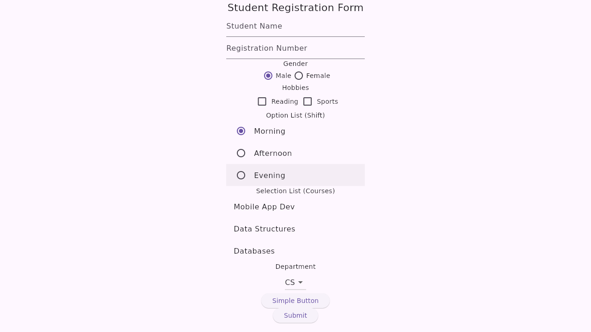
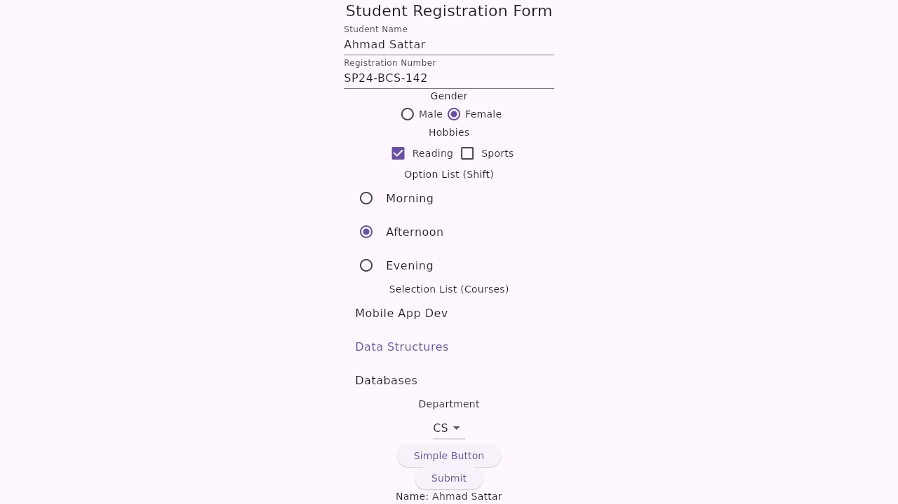
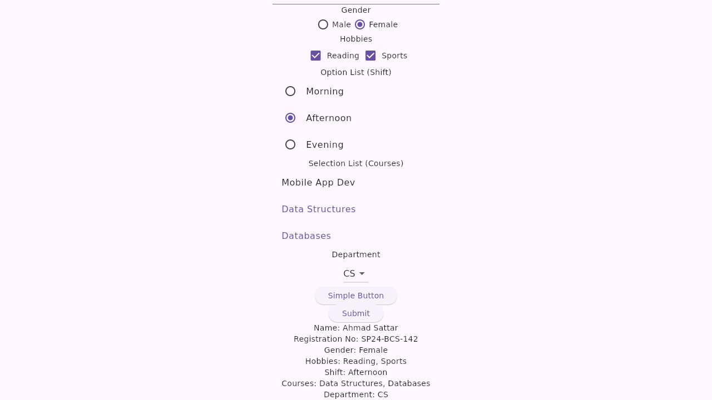

# Quiz 1 — Basic Flutter UI Widgets

**CSC303 – Mobile Application Development · Quiz No. 1 (CLO-1)**

A single Flutter screen that demonstrates the basic input widgets. Everything is
arranged vertically in a `Column` wrapped in a `Center`, with no extra styling —
the point is which widget is used for which type of input, and how the selected
values are read back and displayed.

## Required widgets

| # | Widget | Used for |
|---|--------|----------|
| 1 | `Text` | Heading — "Student Registration Form" |
| 2 | `TextField` | Student Name |
| 3 | `TextField` | Registration Number |
| 4 | `Radio` | Gender (Male / Female) |
| 5 | `Checkbox` | Hobbies (Reading / Sports) |
| 6 | Option list (`RadioListTile`) | Shift — Morning / Afternoon / Evening |
| 7 | Selection list (`ListTile`) | Courses — 3 selectable items |
| 8 | `DropdownButton` | Department (CS / IT / SE / AI) |
| 9 | `ElevatedButton` | Simple button |
| 10 | `ElevatedButton` | Submit button |

Pressing **Submit** collects every selection and prints it below the buttons.

## Project files

```
lib/main.dart          the whole screen
test/widget_test.dart  widget tests (all widgets present + submit works)
pubspec.yaml           project configuration
screenshots/           output of the running application
```

## Running it

```bash
flutter pub get
flutter run
```

## Screenshots

### 1. Form on startup


### 2. Form filled in


### 3. Output after pressing Submit

